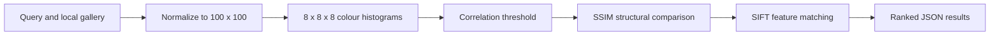

# Judging a Book by Its Cover

### Exploring visual similarity through colour, structure and local features

**Python · OpenCV · scikit-image · Classical computer vision · Reproducible CLI**

Can the visual design of a book cover help identify related books? This academic project explores that question using a staged image-retrieval approach: filter by colour, compare structure, then rank local feature matches. The repository includes the original research notebook, report and proposal, alongside a small, reproducible local-image implementation.

**Authors named in the project report:** Ishika Tarin and Afroza Parvin Disa, Bangladesh University of Engineering and Technology. This is a collaborative academic project; individual contribution claims are not inferred here.

[Project report](Judging_A_Book_By_It_s_Cover.pdf) · [Original notebook](Codes/judgingABookCode.ipynb) · [Validation record](VALIDATION.md)

## At a glance

| Area | What is implemented |
| --- | --- |
| Retrieval pipeline | RGB histogram correlation → SSIM filtering → SIFT descriptor matching |
| Runnable interface | Local-image CLI with JSON output; no API key or GPU required |
| Reproducibility | Pinned dependencies, deterministic synthetic demo and automated tests |
| Research artifacts | Original notebook, book metadata, report, proposal and reference paper |
| Scope | A visual-similarity prototype, **not a validated genre classifier** |

## Try it in two minutes

Python **3.12** is the tested version. Run from the repository root:

```bash
python -m venv .venv
source .venv/bin/activate  # Windows: .venv\Scripts\activate
python -m pip install -r requirements.txt
python cover_match.py --demo
python -m pytest -q
```

The offline demo uses generated patterns to exercise the actual retrieval pipeline. In the verified environment, the identical candidate produced:

```text
Candidate             Histogram correlation   SSIM      SIFT matches
synthetic-identical   1.0000                  1.0000    24
```

These are **smoke-test results**, not book-genre accuracy. An identical-image test checks that the implementation works; it does not establish usefulness on unseen covers.

### Open the visual demo

```bash
python demo_report.py --output demo.html
```

Open `demo.html` in a browser. It shows the generated query and gallery, the three retrieval stages, and scores computed by the same `rank()` function as the CLI. The report is self-contained and makes no network requests. A [pre-generated report](assets/offline-demo.html) is included: download/open it locally because GitHub does not render repository HTML as a webpage.

A browser screenshot is not included: the maintenance environment could generate the report but blocked Chromium's process socket. The report itself is real computed output, not a mockup of a working classifier.

## How it works



1. **Colour screening:** normalized three-channel histograms provide a first-pass comparison. Candidates below the default correlation threshold of `0.9` are excluded.
2. **Structural comparison:** SSIM compares the resized colour images, with channels and data range specified explicitly. Non-positive scores are excluded.
3. **Local features:** SIFT descriptors are compared using a two-nearest-neighbour matcher and Lowe's ratio test (`0.75`). Results are sorted by feature matches, then SSIM.

The CLI uses exact brute-force descriptor matching instead of the notebook's FLANN configuration. It handles images without SIFT descriptors, incomplete neighbour pairs, unreadable inputs and empty result sets. Similarity scores are not probabilities or confidence estimates.

## Use your own images

Use only images you have permission to process:

```bash
python cover_match.py --query /path/query.jpg --gallery /path/gallery
python cover_match.py --query /path/query.jpg --gallery /path/gallery --threshold 0.5
```

The gallery accepts `.png`, `.jpg` and `.jpeg`. A query that is the same file as a gallery image is excluded. A visually different gallery may correctly return no matches at the default threshold. Lowering the threshold broadens retrieval but does not guarantee meaningful recommendations.

## Repository guide

```text
cover_match.py                  Tested local-image retrieval CLI
demo_report.py                 Self-contained visual report generator
tests/                         Regression and smoke tests
requirements.txt               Pinned offline-demo dependencies
Codes/judgingABookCode.ipynb    Original exploratory notebook, unchanged
Codes/shortbook.csv             Original headerless metadata and image URLs
Judging_A_Book_By_It_s_Cover.pdf Original project report
proposal/                      Original proposal slides and PDF
Related paper/                 Reference material
```

## What has been verified

- Deterministic synthetic retrieval demo and local PNG query/gallery execution.
- Tests for identical-image retrieval, missing inputs, empty galleries and featureless images.
- Self-contained HTML report generated from actual retrieval output.
- Pinned-package installation in a dedicated Python 3.12 virtual environment.

See [VALIDATION.md](VALIDATION.md) for the exact verification scope. CI is supplied, but a successful hosted CI run is not claimed before the branch is published.

## Original experiment and limitations

The original notebook additionally explores genre lookup from retrieved covers. It depends on live external image URLs and extra packages (`pandas`, `matplotlib`, `scikit-learn`, `requests`, `Pillow`, `imutils`, Jupyter). It has **not** been rerun end-to-end during this maintenance work.

Important reproduction details:

- Read `shortbook.csv` with `header=None`; it has no header row.
- Some notebook cells assume at least 39 predictions or 500 descriptor matches.
- External image URLs may no longer work. Load pickle caches only when trusted.
- Cached notebook outputs are historical. Its single-example “Accuracy is 100%” output is **not** a dataset-level evaluation.

Colour and layout can correlate poorly with genre, and near-duplicate covers can inflate results. A credible evaluation would use a deduplicated, independently held-out labeled dataset, compare baselines, and report aggregate metrics. No new benchmark or superiority over neural models is claimed here.

## Container recipe

```bash
docker build -t book-cover-demo .
docker run --rm --network none book-cover-demo
```

The supplied container runs the offline demo and tests as an unprivileged user. **Docker was unavailable**, so this recipe has not been built or executed; the Python workflow above was tested directly.

## Provenance

The original research files and history are preserved. The CLI, tests, documentation and visual report are maintenance additions, not new research results. Repository licensing and dataset/image redistribution rights have not been established; this cleanup does not assign a new license.
